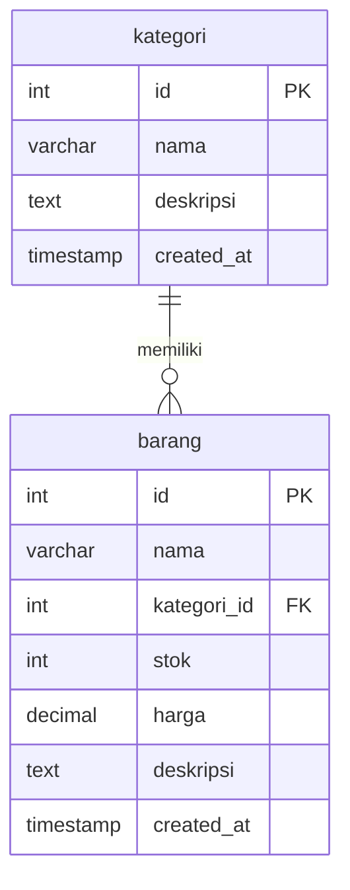

# Inventorimakasih

Sistem manajemen inventaris barang berbasis **PHP MVC** untuk mengelola kategori dan barang. Aplikasi menyediakan CRUD kategori dan barang, validasi input di controller, flash message, pencarian, filter stok, pagination, serta export CSV.

## Fitur

- CRUD kategori
- CRUD barang dengan relasi kategori
- Daftar barang dengan nama kategori (JOIN)
- Ringkasan inventaris: total barang, total kategori, nilai stok, dan barang yang perlu restock
- Pencarian nama/deskripsi/kategori
- Filter kategori dan status stok (habis, menipis, aman, perlu restock)
- Sort dan pagination
- Badge status stok otomatis
- Export CSV sesuai filter aktif
- Flash message sukses/error
- Validasi input di controller
- Layout responsif dengan Tailwind CSS

## Teknologi

- PHP 8.1+ (tanpa framework)
- MySQL/MariaDB
- PDO dengan prepared statement
- Tailwind CSS (CDN)
- HTML, CSS, JavaScript vanilla

## Kebutuhan

- PHP >= 8.1
- Ekstensi `pdo_mysql`
- MySQL/MariaDB
- XAMPP/Laragon (disarankan) atau PHP built-in server
- Koneksi internet untuk Tailwind CDN saat demo

Cek versi PHP:

```bash
php -v
```

## Struktur Folder

```text
Inventorimakasih/
├── public/
│   ├── index.php
│   ├── router.php
│   ├── .htaccess
│   └── assets/
│       ├── css/style.css
│       └── js/script.js
├── app/
│   ├── Controllers/
│   │   ├── Controller.php
│   │   ├── BarangController.php
│   │   └── KategoriController.php
│   ├── Models/
│   │   ├── Model.php
│   │   ├── Barang.php
│   │   └── Kategori.php
│   ├── Views/
│   │   ├── layouts/
│   │   ├── barang/
│   │   ├── kategori/
│   │   └── errors/
│   └── Core/
│       ├── Router.php
│       ├── Database.php
│       └── Helper.php
├── config/
│   └── database.php
├── database/
│   ├── Inventorimakasih.sql
│   └── seed_demo.sql
├── .gitignore
└── README.md
```

## Instalasi

### 1. Siapkan project

Letakkan folder project di dalam `htdocs` XAMPP:

```text
C:\xampp\htdocs\Inventorimakasih
```

Atau clone repository:

```bash
git clone <url-repository> Inventorimakasih
```

### 2. Import database

1. Jalankan **Apache** dan **MySQL** dari XAMPP Control Panel.
2. Buka `http://localhost/phpmyadmin`.
3. Import `database/Inventorimakasih.sql`. File ini membuat database `inventorimakasih`, tabel, relasi, dan data awal.
4. Opsional: import `database/seed_demo.sql` untuk menambah data demo (pagination dan badge stok).

Lewat terminal:

```bash
mysql -u root < database/Inventorimakasih.sql
mysql -u root inventorimakasih < database/seed_demo.sql
```

Di PowerShell, redirection `<` tidak didukung. Gunakan phpMyAdmin atau:

```powershell
Get-Content database\Inventorimakasih.sql | C:\xampp\mysql\bin\mysql.exe -u root
Get-Content database\seed_demo.sql | C:\xampp\mysql\bin\mysql.exe -u root inventorimakasih
```

### 3. Konfigurasi database

Sesuaikan `config/database.php` dengan environment lokal:

```php
return [
    'host' => '127.0.0.1',
    'port' => 3306,
    'database' => 'inventorimakasih',
    'username' => 'root',
    'password' => '',
    'charset' => 'utf8mb4',
];
```

### 4. Jalankan aplikasi

#### Opsi A — XAMPP/Apache (disarankan)

Buka:

```text
http://localhost/Inventorimakasih/public/
```

Pastikan `mod_rewrite` Apache aktif dan `AllowOverride All` diizinkan untuk folder `htdocs`. File `public/.htaccess` sudah menangani routing.

#### Opsi B — PHP built-in server

Dari root project:

```bash
php -S localhost:8000 -t public public/router.php
```

Buka:

```text
http://localhost:8000/
```

`public/router.php` diperlukan agar route seperti `/barang` tetap bekerja dan file statis (CSS/JS) tetap disajikan.

## Rute

| Method | URL | Keterangan |
|---|---|---|
| GET | `/` atau `/barang` | Daftar barang |
| GET | `/barang/tambah` | Form tambah barang |
| POST | `/barang/simpan` | Proses simpan barang |
| GET | `/barang/edit/{id}` | Form edit barang |
| POST | `/barang/update` | Proses update barang |
| POST | `/barang/hapus` | Proses hapus barang |
| GET | `/barang/export` | Export CSV sesuai filter |
| GET | `/kategori` | Daftar kategori |
| GET | `/kategori/tambah` | Form tambah kategori |
| POST | `/kategori/simpan` | Proses simpan kategori |
| GET | `/kategori/edit/{id}` | Form edit kategori |
| POST | `/kategori/update` | Proses update kategori |
| POST | `/kategori/hapus` | Proses hapus kategori |

## Skema Database



Relasi `barang.kategori_id` memakai `ON DELETE RESTRICT`, sehingga kategori yang masih memiliki barang tidak dapat dihapus.

## Validasi

### Barang

| Field | Aturan |
|---|---|
| `nama` | Wajib, maksimal 150 karakter |
| `kategori_id` | Wajib, integer >= 1, harus ada di tabel kategori |
| `stok` | Wajib, bilangan bulat 0–1.000.000 |
| `harga` | Wajib, angka 0–9.999.999.999,99 |
| `deskripsi` | Opsional, maksimal 5.000 karakter |

### Kategori

| Field | Aturan |
|---|---|
| `nama` | Wajib, maksimal 100 karakter |
| `deskripsi` | Opsional, maksimal 5.000 karakter |

Jika validasi gagal, form ditampilkan kembali dengan pesan error per field dan input lama tetap tersimpan.

## Alur Kerja Git

1. Buat branch dari `main`:
   - `feature/barang-crud`
   - `feature/ui-integrasi`
2. Commit dengan pesan yang jelas:
   - `feat: add barang model with kategori join`
   - `feat: add barang controller crud with validation`
   - `feat: add barang views`
   - `feat: add inventory summary search filter pagination`
   - `feat: export barang to csv`
   - `docs: add readme and demo guide`
3. Push branch dan buat Pull Request ke `main`.
4. Minta anggota lain review dan approve.
5. Jangan push langsung ke `main`.

## Checklist Demo

- [ ] Buka `/barang` dan tunjukkan summary cards.
- [ ] Cari barang berdasarkan nama/kategori.
- [ ] Filter status **Perlu Restock**.
- [ ] Ubah sort dan pagination.
- [ ] Tambah barang dengan input tidak valid, tunjukkan error inline.
- [ ] Perbaiki input dan simpan, tunjukkan flash sukses.
- [ ] Edit stok menjadi 0, tunjukkan badge **Habis** dan flash warning.
- [ ] Hapus barang dan tunjukkan flash sukses.
- [ ] Tambah kategori baru, lalu pastikan muncul di dropdown barang.
- [ ] Export CSV dan buka di Excel.
- [ ] Coba hapus kategori yang masih memiliki barang (harus ditolak).
- [ ] Buka tampilan mobile.

## Troubleshooting

### `SQLSTATE[HY000] [2002] Connection refused`

MySQL belum berjalan. Jalankan MySQL dari XAMPP Control Panel, lalu cek `config/database.php`.

### Halaman `/barang` 404

- Jika memakai Apache: pastikan `mod_rewrite` aktif dan `.htaccess` diizinkan.
- Jika memakai PHP built-in server: jalankan dengan `public/router.php` seperti pada Opsi B.

### Tampilan tidak ber-style

Tailwind masih dimuat dari CDN, sehingga membutuhkan koneksi internet. Cek juga Console browser untuk error jaringan.

### `Class "App\..." not found`

Pastikan file berada di folder yang sesuai dengan namespace, dan aplikasi dijalankan dari root project. Autoloader ada di `public/index.php`.

### Port 8000 sudah dipakai

Gunakan port lain:

```bash
php -S localhost:8001 -t public public/router.php
```

### Tidak bisa menghapus kategori

Jika kategori masih memiliki barang, database menolak penghapusan karena foreign key `ON DELETE RESTRICT`. Pindahkan atau hapus barang terlebih dahulu.

## Catatan Keamanan

- Semua query menggunakan PDO prepared statement.
- Output di-escape dengan `e()` untuk mencegah XSS.
- Sort column dan arah dibatasi dengan whitelist.
- Export CSV menetralkan sel yang diawali karakter formula (`=`, `+`, `-`, `@`).
- Aplikasi ini belum memiliki autentikasi/otorisasi karena di luar cakupan tugas.

## Pembagian Tugas

- **Anggota A** — foundation MVC, database, router, base controller/model, CRUD kategori, validasi dasar, layout.
- **Anggota B** — CRUD barang, validasi barang, flash message, summary cards, pencarian/filter/pagination, badge stok, export CSV, responsive UI, README.

## Lisensi

Dibuat untuk tugas mata kuliah **Pemrograman Web**.
